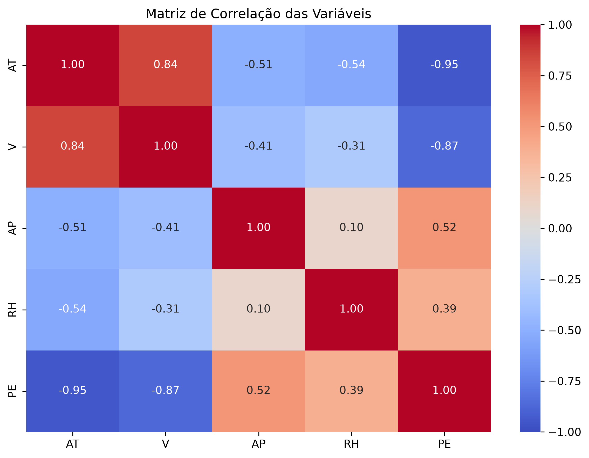
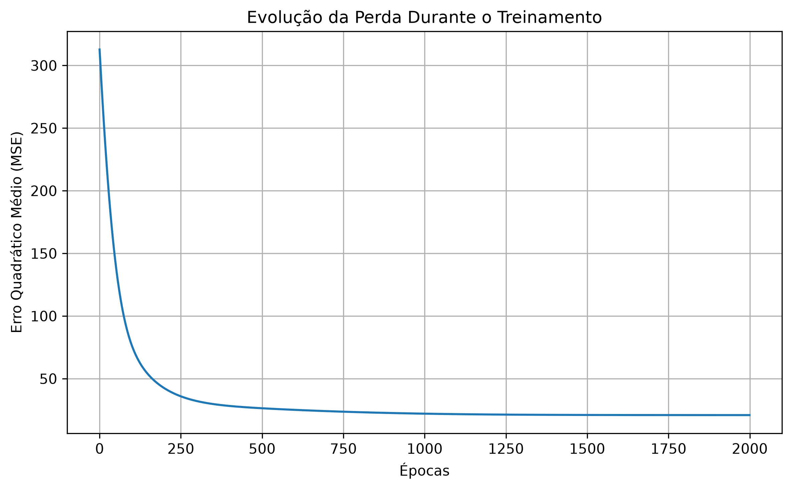
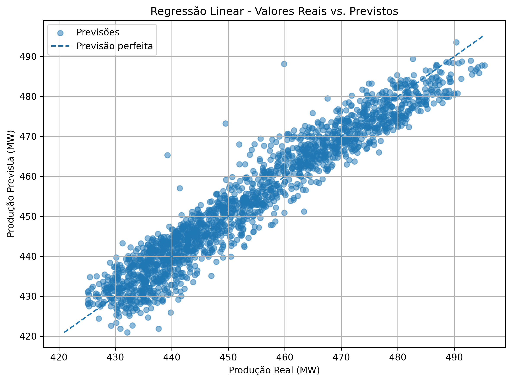
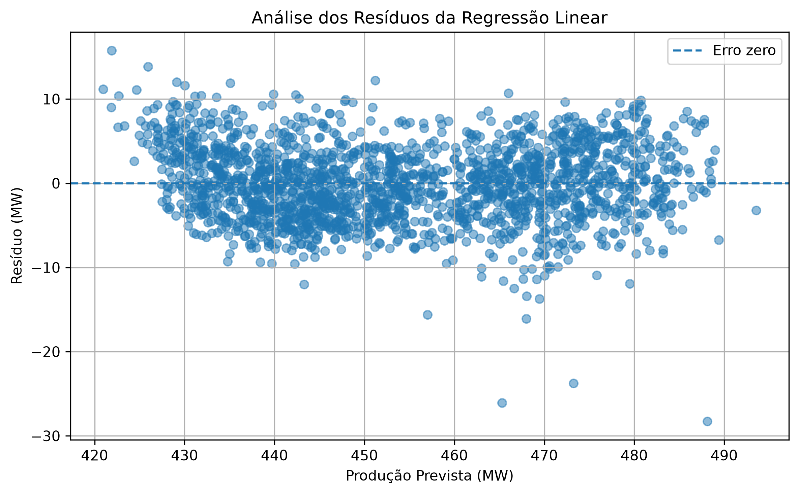

# Problema 1 — Regressão Linear Múltipla

**Disciplina:** Sistemas Inteligentes  
**Algoritmo:** Regressão Linear Múltipla  
**Framework:** PyTorch

## 1. Objetivo

O objetivo deste projeto é desenvolver um modelo de regressão linear múltipla para prever a produção de energia elétrica de uma usina de ciclo combinado, utilizando variáveis ambientais como temperatura, vácuo de escape, pressão atmosférica e umidade relativa.

## 2. Dataset e Pré-processamento

Foi utilizado o dataset *Combined Cycle Power Plant*, disponibilizado pela UCI Machine Learning Repository, contendo 9.568 amostras e cinco variáveis: AT, V, AP, RH e PE.

A análise exploratória identificou que todas as variáveis são numéricas e não apresentam valores ausentes, dispensando a aplicação de técnicas de imputação.

Os dados foram divididos em 80% para treinamento (7.654 amostras) e 20% para teste (1.914 amostras), utilizando `random_state=42`.

As variáveis independentes foram padronizadas por Z-score com `StandardScaler`, ajustado exclusivamente aos dados de treinamento, evitando vazamento de informações do conjunto de teste.

## 3. Análise de Correlação

### 3.1. Correlação com a Produção de Energia

Foram obtidos os seguintes coeficientes de correlação de Pearson:

| Variável | Correlação com PE |
|---|---:|
| AT | -0,9481 |
| V | -0,8698 |
| AP | 0,5184 |
| RH | 0,3898 |

A temperatura ambiente apresentou a maior associação linear com a produção elétrica, seguida pelo vácuo de escape. Ambas possuem correlação negativa, indicando que valores mais elevados dessas variáveis tendem a estar associados à redução da potência produzida.

A pressão atmosférica e a umidade relativa apresentaram correlações positivas, porém de menor intensidade.

### 3.2. Correlação entre as Variáveis Independentes

A maior correlação entre as variáveis independentes ocorreu entre temperatura ambiente e vácuo de escape, com coeficiente de 0,8441.

Esse resultado indica uma forte associação linear entre as duas variáveis e sugere a possibilidade de multicolinearidade.

Apesar disso, todas as variáveis foram mantidas no modelo, conforme solicitado no problema. A correlação entre pares, isoladamente, não é suficiente para determinar toda a extensão da multicolinearidade.

*Figura 1 – Matriz de correlação de Pearson entre as variáveis do dataset.*

## 4. Implementação e Treinamento

O modelo foi implementado utilizando PyTorch, por meio da camada `nn.Linear(4, 1)`, composta por quatro entradas e uma saída.

A regressão linear múltipla é representada por:

\[
\hat{PE}=w_1AT+w_2V+w_3AP+w_4RH+b
\]

Os parâmetros foram aprendidos durante o treinamento, utilizando:

- Função de perda: Mean Squared Error (MSE);
- Otimizador: Adam;
- Taxa de aprendizado: 0,05;
- Número de épocas: 2.000;
- Semente aleatória: 42.

O MSE diminuiu progressivamente durante o treinamento, atingindo aproximadamente 20,8978 na última época.

A curva de treinamento apresentou redução acentuada do erro nas primeiras épocas e posterior estabilização, indicando convergência do processo de otimização.

*Figura 2 – Evolução do erro quadrático médio durante as 2.000 épocas de treinamento.*

### 4.1. Equação do Modelo Treinado

Após o treinamento do modelo com PyTorch, os coeficientes foram recuperados e convertidos para a escala original das variáveis independentes, permitindo representar a regressão linear múltipla pela equação:

\[
\hat{PE} = 449{,}844775 - 1{,}964575AT - 0{,}241544V + 0{,}066723AP - 0{,}154864RH
\]

A temperatura ambiente apresentou o coeficiente negativo de maior magnitude numérica, indicando que seu aumento está associado à redução da potência elétrica prevista, mantendo as demais variáveis constantes.

O vácuo de escape e a umidade relativa também apresentaram coeficientes negativos, enquanto a pressão atmosférica apresentou coeficiente positivo.

Destaca-se que a umidade relativa apresentou correlação simples positiva com a produção elétrica, porém coeficiente negativo na regressão múltipla. Essa diferença pode ser explicada pelas relações existentes entre as variáveis independentes, uma vez que a regressão estima os efeitos condicionais de cada atributo.

Os coeficientes devem ser interpretados considerando as respectivas unidades de medida e não representam, isoladamente, relações de causalidade.

## 5. Avaliação do Modelo

O desempenho foi avaliado com R², RMSE e MAE, utilizando os conjuntos de treinamento e teste.

| Métrica | Treino | Teste |
|---|---:|---:|
| R² | 0,9283 | 0,9301 |
| RMSE (MW) | 4,5714 | 4,5016 |
| MAE (MW) | 3,6323 | 3,5954 |

O modelo apresentou R² de 0,9301 no conjunto de teste, explicando aproximadamente 93,01% da variabilidade observada na produção elétrica.

O RMSE foi de 4,5016 MW, enquanto o MAE foi de 3,5954 MW.

A proximidade entre as métricas de treinamento e teste indica boa capacidade de generalização, sem evidências significativas de sobreajuste nessa avaliação.

### 5.1. Comparação com o Modelo de Referência

Foi utilizada como referência uma previsão constante baseada na média da produção elétrica do conjunto de treinamento.

| Métrica | Regressão Linear | Previsão pela Média |
|---|---:|---:|
| R² | 0,9301 | -0,0004 |
| RMSE (MW) | 4,5016 | 17,0343 |
| MAE (MW) | 3,5954 | 14,8067 |

A regressão linear apresentou desempenho substancialmente superior ao modelo de referência, demonstrando que os atributos ambientais fornecem informações relevantes para a previsão.

### 5.2. Análise Gráfica

O gráfico de valores reais versus previstos apresentou uma concentração dos pontos próximos da diagonal, indicando boa correspondência entre as previsões e os valores observados.

*Figura 3 – Comparação entre a produção elétrica real e a produção prevista pelo modelo.*

A análise dos resíduos identificou alguns erros elevados e padrões na dispersão. Esses comportamentos sugerem que o modelo linear pode não capturar integralmente todas as relações existentes entre as variáveis.

*Figura 4 – Distribuição dos resíduos em função dos valores previstos pelo modelo.*

## 6. Conclusão

O modelo de regressão linear múltipla desenvolvido com PyTorch apresentou resultados satisfatórios na previsão da produção elétrica da usina de ciclo combinado.

A temperatura ambiente e o vácuo de escape demonstraram as associações lineares mais intensas com a variável alvo.

Com R² de 0,9301, RMSE de 4,5016 MW e MAE de 3,5954 MW no conjunto de teste, o modelo demonstrou boa capacidade preditiva e desempenho superior à previsão baseada na média.

Conclui-se que a regressão linear múltipla constitui uma abordagem adequada como modelo inicial para esse problema. Entretanto, a presença de padrões nos resíduos indica que abordagens não lineares poderiam ser investigadas para melhorar as previsões.

## 7. Referência

UCI Machine Learning Repository. *Combined Cycle Power Plant*. Disponível em: https://archive.ics.uci.edu/dataset/294/combined+cycle+power+plant.