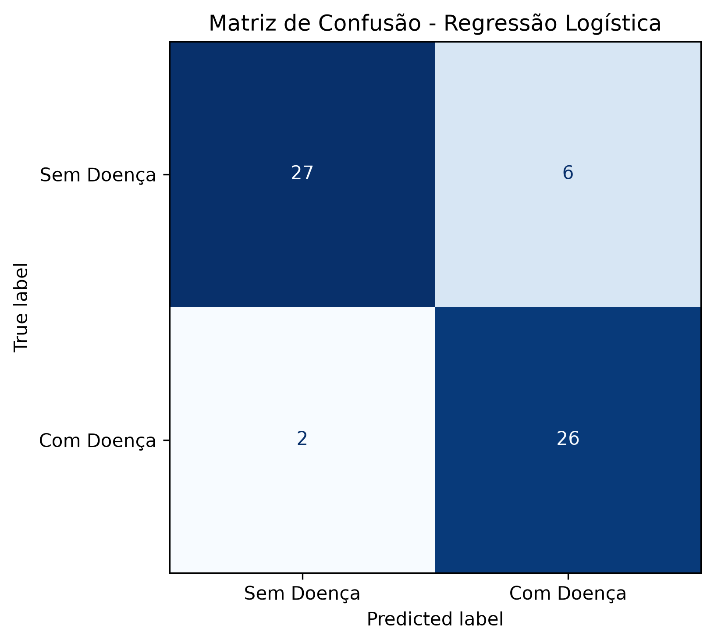
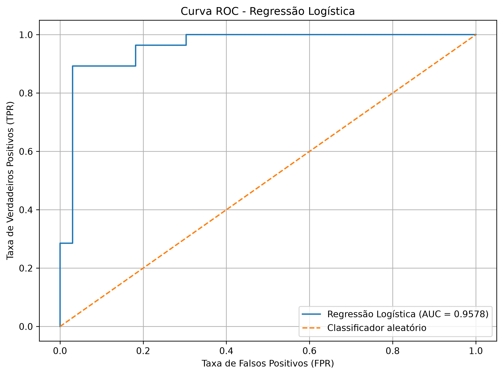

# Problema 2 — Regressão Logística para Previsão de Doenças Cardíacas

**Disciplina:** Sistemas Inteligentes  
**Algoritmo:** Regressão Logística  
**Biblioteca:** Scikit-learn

## 1. Objetivo

O objetivo deste projeto é desenvolver um modelo de classificação binária utilizando regressão logística para identificar a presença ou ausência de doenças cardíacas a partir de características clínicas de pacientes.

O modelo foi desenvolvido utilizando o algoritmo LogisticRegression do scikit-learn, conforme os parâmetros estabelecidos no enunciado.

## 2. Dataset e Pré-processamento

Foi utilizado o dataset *Heart Disease Cleveland*, disponibilizado pela UCI Machine Learning Repository, contendo 303 registros de pacientes, 13 variáveis independentes e uma variável alvo.

O diagnóstico original, representado pela variável `num`, apresenta valores entre 0 e 4. Para realizar a classificação binária, os valores foram transformados em duas classes:

- Classe 0: ausência de doença cardíaca;
- Classe 1: presença de doença cardíaca, agrupando os diagnósticos originais de 1 a 4.

Após a transformação, foram identificados 164 pacientes sem doença e 139 pacientes com doença, representando aproximadamente 54,13% e 45,87% do dataset, respectivamente.

### 2.1. Tratamento de Valores Ausentes

A análise exploratória identificou quatro valores ausentes na variável `ca` e dois na variável `thal`.

Os valores ausentes das variáveis numéricas foram tratados por imputação pela mediana, enquanto as variáveis categóricas receberam imputação pela categoria mais frequente.

As variáveis numéricas também foram padronizadas utilizando Z-score, e as variáveis categóricas foram transformadas utilizando One-Hot Encoding.

Os procedimentos foram ajustados exclusivamente com os dados de treinamento, evitando vazamento de informações do conjunto de teste.

Após o pré-processamento, o conjunto passou a apresentar 25 atributos, sem valores ausentes.

### 2.2. Divisão dos Dados

Os dados foram divididos em 80% para treinamento e 20% para teste, utilizando `random_state=42` e divisão estratificada.

Foram obtidas 242 amostras de treinamento e 61 amostras de teste.

A estratificação permitiu preservar aproximadamente a proporção original das classes nos dois conjuntos.

## 3. Implementação e Treinamento

O modelo foi implementado utilizando a classe `LogisticRegression` da biblioteca scikit-learn, com os parâmetros:

| Parâmetro | Valor |
|---|---|
| solver | liblinear |
| random_state | 42 |
| max_iter | 1000 |

A regressão logística utiliza uma função sigmoide para transformar uma combinação linear dos atributos em uma probabilidade de pertencimento à classe positiva.

A função é representada por:

$
P(y=1\mid X)=\frac{1}{1+e^{-(w^TX+b)}}
$

O treinamento foi realizado sobre os atributos previamente processados, utilizando as 242 amostras do conjunto de treinamento.

### 3.1. Convergência do Modelo

O algoritmo concluiu o processo de otimização em **6 iterações**, valor significativamente inferior ao limite máximo de 1.000 iterações.

O resultado indica que o modelo atingiu o critério de convergência do otimizador sem necessidade de utilizar todas as iterações disponíveis.

## 4. Avaliação do Modelo

A avaliação foi realizada utilizando exclusivamente as 61 amostras do conjunto de teste.

Foram calculadas as métricas de acurácia, precisão, recall, F1-score e ROC-AUC.

| Métrica | Resultado |
|---|---:|
| Acurácia | 0,8689 |
| Precisão — Classe 1 | 0,8125 |
| Recall — Classe 1 | 0,9286 |
| F1-score — Classe 1 | 0,8667 |
| ROC-AUC | 0,9578 |

A acurácia de 86,89% indica que o modelo classificou corretamente 53 dos 61 pacientes utilizados no teste.

A precisão de 81,25% indica que, entre os pacientes classificados como positivos, essa proporção realmente pertencia à classe de presença de doença.

O recall de 92,86% demonstra que o modelo conseguiu identificar corretamente 26 dos 28 pacientes com doença cardíaca.

O F1-score de 0,8667 indica um bom equilíbrio entre precisão e recall para a classe positiva.

### 4.1. Avaliação por Classe

| Classe | Precisão | Recall | F1-score | Suporte |
|---|---:|---:|---:|---:|
| Sem doença | 0,9310 | 0,8182 | 0,8710 | 33 |
| Com doença | 0,8125 | 0,9286 | 0,8667 | 28 |

Os resultados mostram maior precisão na identificação da classe sem doença, enquanto a classe com doença apresentou maior recall.

Essa característica demonstra que o modelo conseguiu identificar a maior parte dos pacientes positivos, embora tenha classificado incorretamente alguns pacientes negativos como positivos.

### 4.2. Matriz de Confusão

A matriz de confusão apresentou os seguintes resultados:

| Resultado | Quantidade |
|---|---:|
| Verdadeiros negativos | 27 |
| Falsos positivos | 6 |
| Falsos negativos | 2 |
| Verdadeiros positivos | 26 |

*Figura 1 – Matriz de confusão do modelo de regressão logística no conjunto de teste.*

Foram identificados oito erros de classificação, sendo seis falsos positivos e dois falsos negativos.

Embora os falsos positivos tenham ocorrido com maior frequência, os falsos negativos merecem atenção especial no contexto de triagem de doenças cardíacas, pois representam pacientes com doença classificados como negativos.

O baixo número de falsos negativos observado no experimento contribuiu para o recall elevado da classe positiva.

### 4.3. Curva ROC e AUC

A curva ROC permite avaliar a capacidade do modelo de distinguir pacientes com e sem doença cardíaca considerando diferentes limiares de decisão.

*Figura 2 – Curva ROC e área sob a curva (AUC) do modelo de regressão logística.*

O modelo apresentou AUC de 0,9578, indicando elevada capacidade de discriminação entre as classes no conjunto avaliado.

A curva apresentou comportamento próximo ao canto superior esquerdo do gráfico, evidenciando uma relação favorável entre a taxa de verdadeiros positivos e a taxa de falsos positivos.

## 5. Discussão dos Resultados

O modelo apresentou desempenho satisfatório na tarefa de classificação binária, alcançando acurácia de 86,89% e recall de 92,86% para a classe positiva.

A capacidade de identificar pacientes com doença constitui um aspecto importante do modelo, especialmente considerando as possíveis consequências de falsos negativos em aplicações médicas.

Por outro lado, a ocorrência de seis falsos positivos demonstra que o classificador também apresenta limitações na identificação dos pacientes sem doença.

Além disso, o tamanho reduzido do conjunto de dados e a utilização de uma única divisão treino/teste limitam a generalização das conclusões.

Os resultados obtidos demonstram potencial para fins acadêmicos e experimentais, mas não representam validação suficiente para aplicação clínica.

## 6. Conclusão

A regressão logística apresentou bom desempenho na identificação de doenças cardíacas a partir de variáveis clínicas.

O modelo convergiu em apenas seis iterações e alcançou acurácia de 86,89%, F1-score de 0,8667 e ROC-AUC de 0,9578 no conjunto de teste.

A matriz de confusão demonstrou que 53 dos 61 pacientes foram classificados corretamente, com apenas dois falsos negativos.

Conclui-se que a regressão logística constitui uma abordagem adequada para a classificação binária proposta, apresentando boa capacidade de discriminação entre as classes.

Entretanto, o número limitado de amostras e a presença de erros de classificação indicam a necessidade de validações adicionais antes de considerar qualquer aplicação prática em ambientes clínicos.

## 7. Referência

UCI Machine Learning Repository. *Heart Disease*. Disponível em: https://archive.ics.uci.edu/dataset/45/heart+disease.