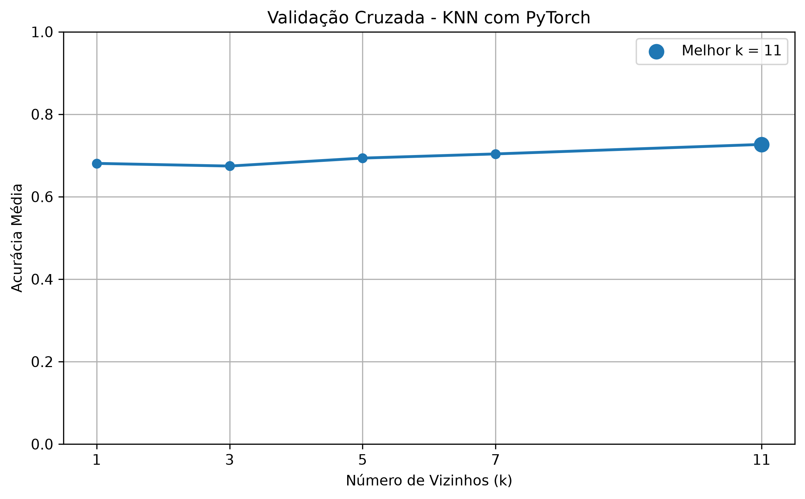
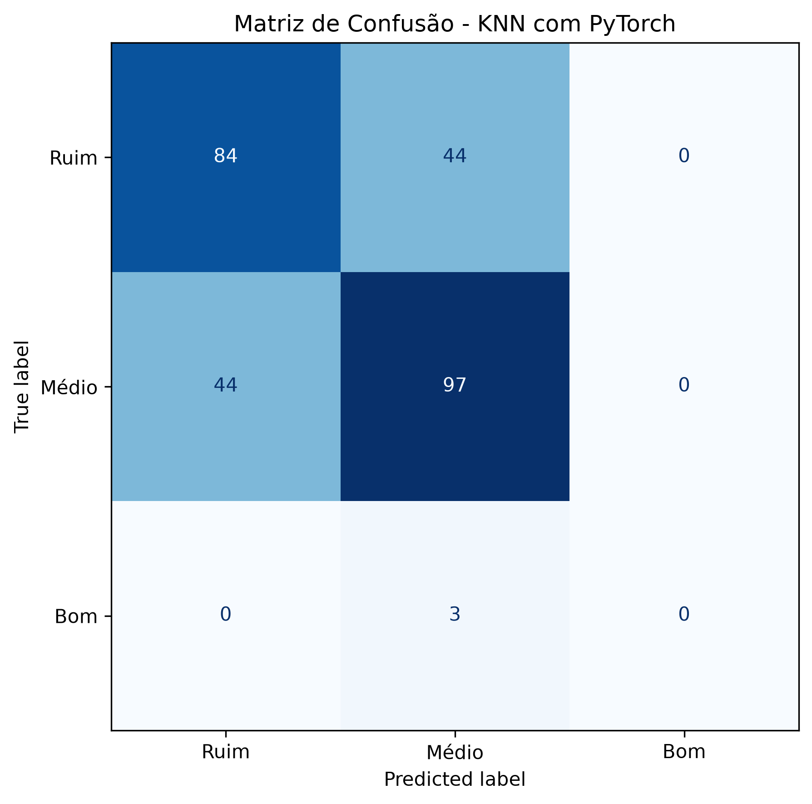

# Problema 3 — Classificação da Qualidade de Vinhos Utilizando KNN

**Disciplina:** Sistemas Inteligentes  
**Algoritmo:** K-Nearest Neighbors (KNN)  
**Framework:** PyTorch

## 1. Objetivo

O objetivo deste projeto é desenvolver um modelo de classificação utilizando o algoritmo K-Nearest Neighbors (KNN) para categorizar vinhos tintos em três níveis de qualidade, com base em suas características físico-químicas.

O algoritmo foi implementado utilizando PyTorch, enquanto as bibliotecas scikit-learn, pandas, NumPy e Matplotlib foram utilizadas como ferramentas auxiliares para pré-processamento, validação e análise dos resultados.

## 2. Dataset e Preparação dos Dados

Foi utilizado o arquivo `winequality-red.csv`, pertencente ao dataset *Wine Quality*, disponibilizado pela UCI Machine Learning Repository.

O conjunto original contém 1.599 amostras de vinhos tintos, descritas por 11 atributos físico-químicos e uma variável de qualidade.

A análise exploratória identificou que todos os atributos são numéricos e não apresentam valores ausentes.

Entretanto, foram encontrados 240 registros completamente duplicados. Como esses registros poderiam favorecer artificialmente as previsões do KNN caso aparecessem em conjuntos diferentes, optou-se pela remoção das duplicatas exatas antes da divisão dos dados.

Após esse tratamento, permaneceram 1.359 amostras. Essa escolha metodológica pressupõe que manter observações idênticas não é necessário para o objetivo do experimento, embora registros repetidos também possam representar observações legítimas.

### 2.1. Recodificação das Classes

A variável original `quality` foi transformada em três categorias:

| Classe | Categoria | Intervalo de qualidade |
|---|---|---|
| 0 | Ruim | Notas menores ou iguais a 5 |
| 1 | Médio | Notas 6 e 7 |
| 2 | Bom | Notas maiores ou iguais a 8 |

Após a remoção dos registros duplicados, a distribuição ficou:

| Classe | Quantidade |
|---|---:|
| Ruim | 640 |
| Médio | 702 |
| Bom | 17 |
| **Total** | **1.359** |

Foi identificado um desbalanceamento acentuado, principalmente na classe Bom, que representa aproximadamente 1,25% das amostras restantes.

Esse desequilíbrio pode prejudicar o algoritmo, pois a classificação é determinada pela votação majoritária dos vizinhos mais próximos.

### 2.2. Divisão dos Dados

Os dados foram divididos em 80% para treinamento e 20% para teste, com `random_state=42` e estratificação pela variável alvo.

Foram obtidas 1.087 amostras para treinamento e 272 para teste.

| Classe | Treinamento | Teste |
|---|---:|---:|
| Ruim | 512 | 128 |
| Médio | 561 | 141 |
| Bom | 14 | 3 |

A divisão estratificada manteve aproximadamente as proporções das classes nos dois conjuntos.

### 2.3. Padronização dos Atributos

Foi aplicada a padronização por Z-score, representada por:

$$
z=\frac{x-\mu}{\sigma}
$$

Em que $\mu$ representa a média e $\sigma$ o desvio padrão do atributo no conjunto de treinamento.

A padronização é fundamental para o KNN porque o algoritmo utiliza distâncias entre amostras. Sem essa transformação, atributos com escalas numericamente maiores poderiam dominar o cálculo da distância euclidiana.

Os parâmetros de padronização foram calculados exclusivamente sobre os dados de treinamento e posteriormente aplicados ao conjunto de teste.

Durante a validação cruzada, a padronização também foi reajustada separadamente em cada fold, evitando vazamento de informações.

## 3. Implementação do Algoritmo KNN

O algoritmo KNN foi implementado utilizando PyTorch, por meio de operações tensoriais para calcular as distâncias e selecionar os vizinhos mais próximos.

A distância euclidiana entre duas amostras é definida por:

$$
d(x,y)=\sqrt{\sum_{i=1}^{n}(x_i-y_i)^2}
$$

A implementação utilizou:

- `torch.cdist()`: cálculo das distâncias euclidianas;
- `torch.topk()`: seleção dos vizinhos mais próximos;
- `torch.nn.functional.one_hot()`: contagem dos votos por classe;
- `torch.argmax()`: identificação da classe com maior quantidade de votos.

Diferentemente de algoritmos baseados na otimização de parâmetros, o KNN utiliza diretamente as amostras do conjunto de treinamento para realizar as classificações.

## 4. Escolha do Melhor Valor de K

Foram avaliados os valores de k = 1, 3, 5, 7 e 11, utilizando validação cruzada estratificada de cinco folds exclusivamente sobre o conjunto de treinamento.

A acurácia média foi utilizada como critério de seleção.

### 4.1. Resultados da Validação Cruzada

| k | Acurácia média | Desvio padrão |
|---|---:|---:|
| 1 | 0,6808 | 0,0322 |
| 3 | 0,6743 | 0,0182 |
| 5 | 0,6936 | 0,0222 |
| 7 | 0,7038 | 0,0196 |
| 11 | **0,7268** | 0,0216 |

O melhor desempenho médio foi obtido com **k = 11**, alcançando acurácia de 72,68% na validação cruzada.

*Figura 1 – Acurácia média da validação cruzada em função do número de vizinhos.*

### 4.2. Influência do Número de Vizinhos

Valores muito baixos de k tornam o modelo mais sensível a ruídos e variações locais, aumentando o risco de overfitting.

Por outro lado, valores excessivamente elevados podem suavizar as fronteiras de decisão e favorecer as classes majoritárias, provocando underfitting.

Nos experimentos realizados, k = 11 apresentou o melhor resultado entre os valores avaliados.

Entretanto, esse resultado não garante que valores superiores a 11 apresentariam desempenho inferior, pois não foram investigados.

## 5. Avaliação do Modelo

O modelo foi avaliado sobre as 272 amostras do conjunto de teste, utilizando k = 11.

Foram calculadas as métricas de acurácia, precisão, recall e F1-score.

### 5.1. Acurácia Geral

O modelo alcançou acurácia de **0,6654**, correspondente a aproximadamente 66,54% de classificações corretas.

Das 272 amostras avaliadas, 181 foram classificadas corretamente e 91 incorretamente.

A acurácia obtida foi inferior à média de 72,68% observada durante a validação cruzada.

Essa diferença sugere variação de desempenho entre os subconjuntos avaliados, mas não constitui evidência suficiente para afirmar a ocorrência de overfitting.

### 5.2. Métricas por Classe

| Classe | Precisão | Recall | F1-score | Suporte |
|---|---:|---:|---:|---:|
| Ruim | 0,6562 | 0,6562 | 0,6562 | 128 |
| Médio | 0,6736 | 0,6879 | 0,6807 | 141 |
| Bom | 0,0000 | 0,0000 | 0,0000 | 3 |

O modelo apresentou desempenho semelhante nas classes Ruim e Médio.

Entretanto, a classe Bom apresentou precisão, recall e F1-score iguais a zero, pois nenhuma amostra dessa categoria foi corretamente identificada e nenhuma previsão foi atribuída a ela.

A média macro do F1-score foi de 0,4457, evidenciando que o desempenho não foi equilibrado entre as três classes.

O resultado está associado, em parte, ao forte desbalanceamento do dataset. Contudo, a existência de apenas três amostras da classe Bom no teste também limita a precisão das conclusões específicas dessa categoria.

### 5.3. Matriz de Confusão

A matriz de confusão apresentou os seguintes resultados:

| Classe real | Ruim | Médio | Bom |
|---|---:|---:|---:|
| Ruim | 84 | 44 | 0 |
| Médio | 44 | 97 | 0 |
| Bom | 0 | 3 | 0 |

*Figura 2 – Matriz de confusão do classificador KNN implementado com PyTorch.*

A matriz demonstra que as maiores dificuldades ocorreram na diferenciação entre vinhos Ruins e Médios.

Também foi observado que os três vinhos classificados originalmente como Bons foram previstos como Médios.

### 5.4. Análise dos Erros

Foram identificados os seguintes erros:

| Classe real | Classe prevista | Quantidade |
|---|---|---:|
| Ruim | Médio | 44 |
| Médio | Ruim | 44 |
| Bom | Médio | 3 |

Portanto, **o modelo apresentou maior frequência de erros entre as classes Ruim e Médio, totalizando 88 classificações incorretas**.

Essa dificuldade pode estar relacionada à proximidade das características físico-químicas de vinhos com classificações de qualidade intermediárias.

A ausência de previsões para a classe Bom evidencia uma limitação adicional, associada à pequena quantidade de exemplos dessa categoria e à predominância das demais classes na votação dos vizinhos.

## 6. Discussão dos Resultados

A implementação do KNN com PyTorch demonstrou capacidade de identificar padrões relacionados à qualidade dos vinhos, principalmente nas classes Ruim e Médio.

Entretanto, a acurácia geral de 66,54% não representa um desempenho satisfatório para todas as categorias, especialmente considerando que a classe Bom não apresentou nenhuma previsão correta.

O elevado desbalanceamento das classes constitui uma das principais dificuldades do problema, pois favorece as categorias mais frequentes.

Além disso, a escolha do número de vizinhos baseada exclusivamente na acurácia pode beneficiar modelos que acertam as classes majoritárias, mesmo apresentando desempenho insuficiente na classe minoritária.

Como possíveis melhorias futuras, poderiam ser investigadas técnicas de balanceamento aplicadas exclusivamente aos dados de treinamento, votação ponderada pela distância, métricas de seleção sensíveis ao desbalanceamento e diferentes configurações de k.

Essas alternativas não foram aplicadas no experimento principal, preservando a metodologia inicialmente definida.

## 7. Conclusão

O projeto permitiu implementar e avaliar o algoritmo K-Nearest Neighbors utilizando PyTorch para a classificação da qualidade de vinhos tintos.

A validação cruzada de cinco folds identificou k = 11 como o melhor valor entre os candidatos avaliados, com acurácia média de 72,68%.

Na avaliação final, o modelo apresentou acurácia de 66,54%, com desempenho semelhante nas classes Ruim e Médio, mas incapacidade de identificar corretamente a classe Bom.

As maiores confusões ocorreram entre as categorias Ruim e Médio, totalizando 88 erros.

Conclui-se que o KNN constitui uma abordagem viável para investigar a classificação de qualidade dos vinhos, mas a configuração avaliada apresentou limitações importantes diante do desbalanceamento das classes.

Os resultados reforçam a necessidade de considerar métricas individuais por classe, e não somente a acurácia geral, durante a avaliação de classificadores multiclasse.

## 8. Referência

UCI Machine Learning Repository. *Wine Quality*. Disponível em: https://archive.ics.uci.edu/dataset/186/wine+quality.