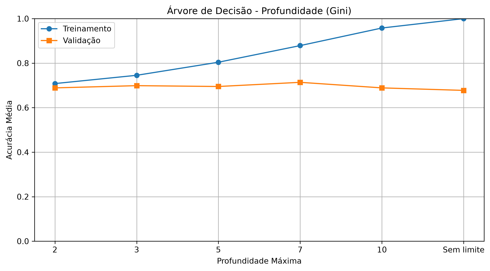
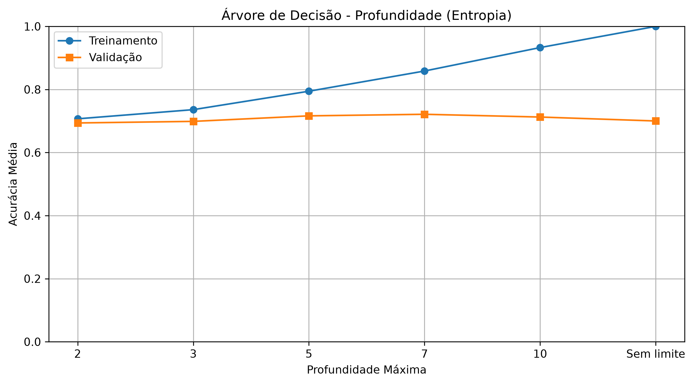
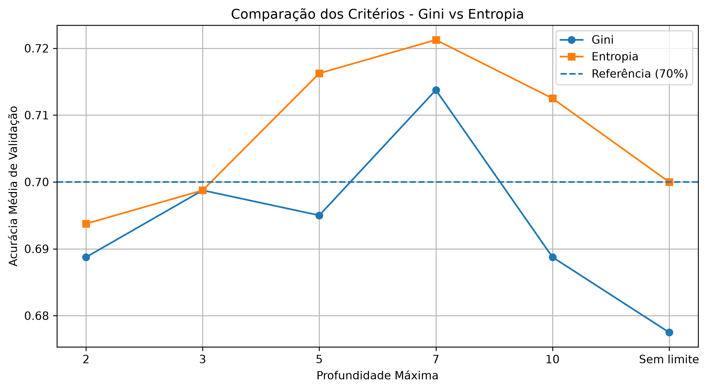
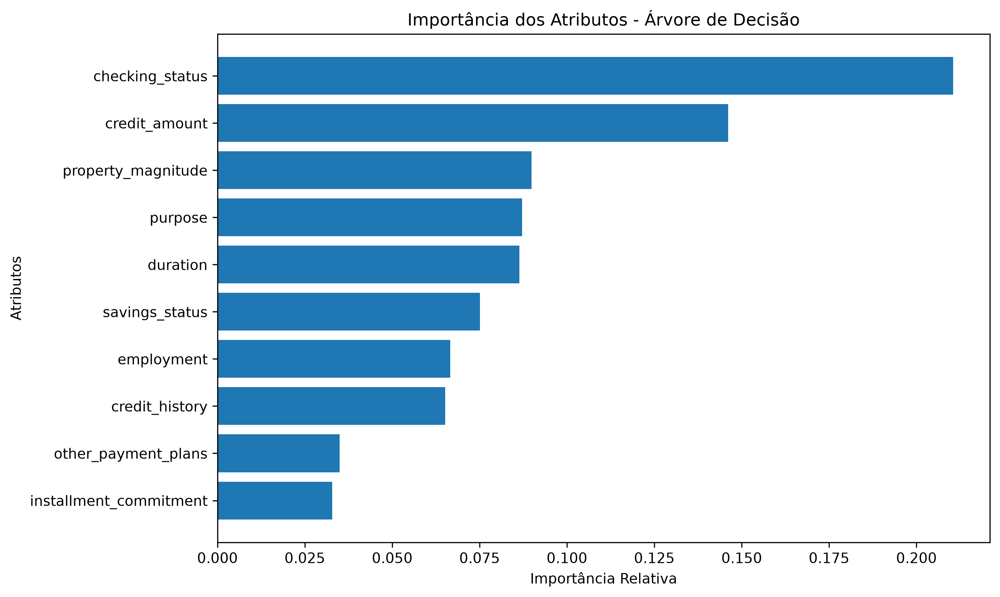
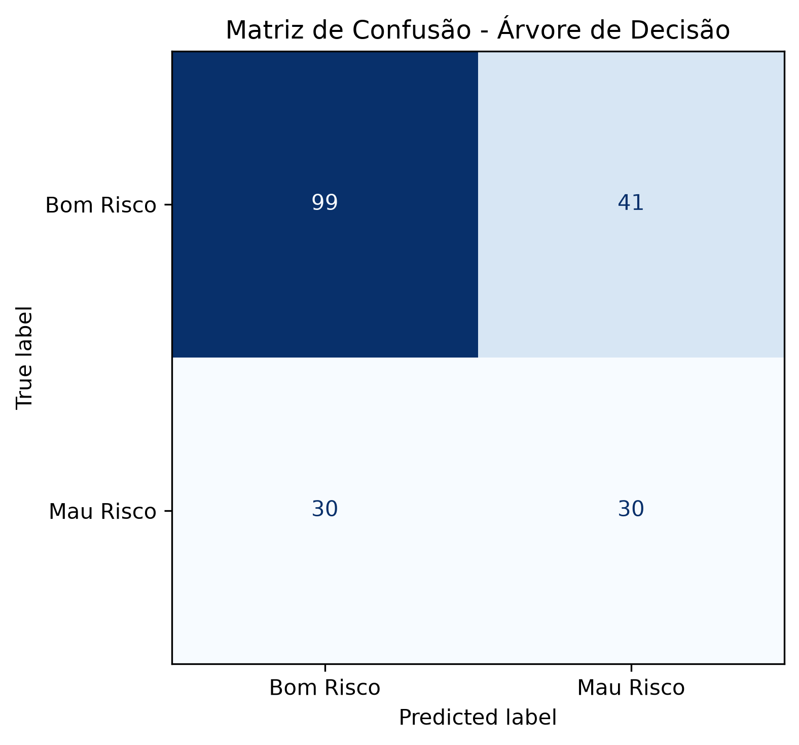

# Problema 4 — Classificação de Risco de Crédito Utilizando Árvores de Decisão

**Disciplina:** Sistemas Inteligentes  
**Algoritmo:** Árvore de Decisão  
**Framework:** PyTorch

## 1. Objetivo

O objetivo deste projeto é desenvolver um modelo de classificação utilizando árvores de decisão para categorizar solicitantes de crédito como bons ou maus riscos, a partir de informações cadastrais e financeiras.

O algoritmo foi implementado utilizando PyTorch para o cálculo das impurezas, seleção das divisões e construção recursiva dos nós. Foram utilizadas bibliotecas auxiliares para pré-processamento, validação cruzada, métricas e visualização.

## 2. Dataset e Pré-processamento

Foi utilizado o dataset *Statlog (German Credit Data)*, disponibilizado pela UCI Machine Learning Repository, por meio da versão `credit-g` do OpenML.

O conjunto possui 1.000 registros, com 20 atributos independentes, sendo sete numéricos e 13 categóricos.

A análise exploratória não identificou valores ausentes nem registros completamente duplicados.

### 2.1. Distribuição das Classes

A variável alvo foi convertida para uma representação binária:

| Classe | Categoria | Quantidade | Percentual |
|---|---|---:|---:|
| 0 | Bom risco | 700 | 70% |
| 1 | Mau risco | 300 | 30% |

A distribuição demonstra um desbalanceamento entre as classes, o que exige atenção durante a avaliação, pois um classificador que sempre previsse Bom Risco alcançaria 70% de acurácia.

### 2.2. Codificação dos Atributos

Os atributos categóricos foram transformados utilizando One-Hot Encoding, enquanto os atributos numéricos foram mantidos em suas escalas originais.

Após a codificação, os 20 atributos passaram a ser representados por 61 colunas numéricas.

A normalização não foi aplicada porque árvores de decisão utilizam comparações entre valores e limiares para dividir os dados, em vez de distâncias euclidianas. Dessa forma, transformações de escala que preservam a ordenação dos valores não alteram as partições possíveis.

### 2.3. Divisão dos Dados

Os dados foram divididos em 80% para treinamento e 20% para teste, utilizando `random_state=42` e estratificação pela variável alvo.

| Classe | Treinamento | Teste |
|---|---:|---:|
| Bom risco | 560 | 140 |
| Mau risco | 240 | 60 |
| **Total** | **800** | **200** |

Durante a validação cruzada, o One-Hot Encoding foi ajustado independentemente em cada fold, utilizando somente os respectivos dados de treinamento.

## 3. Implementação da Árvore de Decisão

A árvore foi implementada com PyTorch, utilizando uma estrutura recursiva responsável por encontrar divisões, criar nós e classificar as amostras.

Foram implementados os critérios de impureza de Gini e Entropia.

O índice de Gini é definido por:

$$
Gini=1-\sum_{i=1}^{C}p_i^2
$$

A Entropia é definida por:

$$
H=-\sum_{i=1}^{C}p_i\log_2(p_i)
$$

A seleção das divisões foi realizada pela maximização do ganho de impureza, considerando as proporções de amostras encaminhadas aos nós filhos.

### 3.1. Impureza Inicial

Para as 800 amostras de treinamento, com 560 bons pagadores e 240 maus pagadores, foram obtidos:

| Critério | Impureza inicial |
|---|---:|
| Gini | 0,4200 |
| Entropia | 0,8813 |

A primeira divisão encontrada com Gini utilizou a categoria `checking_status_no checking`, com limiar de 0,5 e ganho de impureza de aproximadamente 0,042189.

A divisão separou os clientes em dois grupos, apresentando proporções diferentes de mau risco.

## 4. Controle de Complexidade e Validação Cruzada

Foram avaliadas árvores com profundidades máximas de 2, 3, 5, 7, 10 e sem limite, utilizando validação cruzada estratificada de cinco folds.

O experimento foi realizado inicialmente com Gini e posteriormente repetido com Entropia, mantendo as mesmas divisões dos dados.

### 4.1. Resultados com Gini

| Profundidade | Acurácia Treino | Acurácia Validação |
|---|---:|---:|
| 2 | 0,7081 | 0,6887 |
| 3 | 0,7453 | 0,6988 |
| 5 | 0,8041 | 0,6950 |
| 7 | 0,8788 | **0,7138** |
| 10 | 0,9578 | 0,6887 |
| Sem limite | 1,0000 | 0,6775 |

O melhor desempenho de validação com Gini foi obtido na profundidade 7, com acurácia média de 71,38%.

*Figura 1 – Acurácias médias de treinamento e validação para diferentes profundidades utilizando Gini.*

### 4.2. Resultados com Entropia

| Profundidade | Acurácia Treino | Acurácia Validação |
|---|---:|---:|
| 2 | 0,7069 | 0,6937 |
| 3 | 0,7359 | 0,6987 |
| 5 | 0,7944 | 0,7163 |
| 7 | 0,8584 | **0,7212** |
| 10 | 0,9328 | 0,7125 |
| Sem limite | 1,0000 | 0,7000 |

A Entropia apresentou seu melhor desempenho na profundidade 7, com acurácia média de validação de 72,12%.

*Figura 2 – Acurácias médias de treinamento e validação utilizando Entropia.*

### 4.3. Comparação entre Gini e Entropia

*Figura 3 – Comparação das acurácias médias de validação entre os critérios.*

O melhor resultado com Entropia foi 0,74 ponto percentual superior ao melhor resultado com Gini.

Embora a diferença seja pequena, a configuração com **Entropia e profundidade máxima 7** apresentou a maior acurácia média de validação, sendo selecionada para a construção do modelo definitivo.

### 4.4. Underfitting e Overfitting

Os resultados mostram que árvores com profundidades pequenas apresentam capacidade limitada de representar os padrões do conjunto de dados, caracterizando possível underfitting.

Com o aumento da profundidade, a acurácia de treinamento cresce progressivamente. Entretanto, a acurácia de validação não acompanha esse crescimento de maneira contínua.

Árvores sem limite atingiram 100% de acurácia de treinamento nos dois critérios, mas apresentaram desempenhos inferiores na validação, evidenciando overfitting.

A profundidade 7 foi selecionada por apresentar o melhor equilíbrio observado entre as configurações avaliadas, embora ainda existam diferenças consideráveis entre treinamento e validação.

## 5. Interpretação do Modelo

A árvore definitiva foi construída utilizando Entropia, profundidade máxima 7 e todas as 800 amostras de treinamento.

A acurácia de treinamento foi de 83,63%.

### 5.1. Importância dos Atributos

A importância dos atributos foi calculada por meio da soma ponderada dos ganhos de impureza das divisões.

Como os atributos categóricos foram transformados em múltiplas colunas, suas importâncias foram agrupadas para recuperar as contribuições dos 20 atributos originais.

Os três atributos mais importantes foram:

| Atributo | Importância |
|---|---:|
| checking_status | 0,210479 |
| credit_amount | 0,146117 |
| property_magnitude | 0,089817 |

A situação da conta corrente apresentou a maior importância relativa, seguida pelo valor do crédito solicitado e pela característica patrimonial do cliente.

*Figura 4 – Dez atributos com maior importância na classificação de risco de crédito.*

Esses resultados representam a importância preditiva dos atributos dentro da árvore treinada, não constituindo relações de causalidade.

### 5.2. Regras da Folha com Maior Quantidade de Maus Pagadores

Foi identificado o caminho da raiz até a folha com a maior quantidade absoluta de amostras pertencentes à classe Mau Risco.

O caminho contempla as seguintes condições:

1. O cliente não pertence à categoria `no checking` da variável `checking_status`.
2. A duração do empréstimo é superior a 11 meses.
3. A poupança está na categoria inferior a 100 unidades monetárias.
4. A duração do empréstimo é superior a 15 meses.
5. O valor do crédito solicitado é de até 11.141 unidades monetárias.
6. A duração do empréstimo é de até 47 meses.
7. A finalidade do crédito é diferente da aquisição de veículo usado.

Simplificando as condições, o grupo corresponde a clientes com empréstimos de 16 a 47 meses, valor solicitado de até 11.141 unidades monetárias, poupança inferior a 100 unidades monetárias, finalidade diferente de veículo usado e categoria de conta corrente distinta de `no checking`.

A folha contém 143 amostras, distribuídas da seguinte forma:

| Classe | Quantidade |
|---|---:|
| Bom risco | 58 |
| Mau risco | 85 |
| Total | 143 |

Como 59,44% das amostras pertencem à classe Mau Risco, a árvore atribui a essa folha a classe 1.

As regras permitem interpretar o processo decisório do modelo, mas não devem ser utilizadas isoladamente como critérios reais de concessão de crédito.

### 5.3. Visualização da Árvore

A árvore final possui 111 nós, incluindo nós de divisão e folhas.

*Figura 5 – Visualização gráfica da árvore de decisão treinada utilizando PyTorch, Entropia e profundidade máxima 7.*

A estrutura apresenta as condições de divisão, a quantidade de amostras, a distribuição das classes e as classificações das folhas. A versão SVG permite examinar as ramificações com maior detalhamento.

## 6. Avaliação Final do Modelo

A avaliação final foi realizada utilizando as 200 amostras do conjunto de teste, que não participaram do treinamento nem da seleção dos hiperparâmetros.

### 6.1. Métricas de Classificação

Foram obtidos:

| Métrica | Resultado |
|---|---:|
| Acurácia | 0,6450 |
| Precisão — Mau Risco | 0,4225 |
| Recall — Mau Risco | 0,5000 |
| F1-score — Mau Risco | 0,4580 |

A acurácia de 64,50% indica que o modelo classificou corretamente 129 dos 200 clientes.

O recall de 50% para Mau Risco demonstra que apenas metade dos 60 clientes dessa classe foi identificada corretamente.

### 6.2. Métricas por Classe

| Classe | Precisão | Recall | F1-score | Suporte |
|---|---:|---:|---:|---:|
| Bom Risco | 0,7674 | 0,7071 | 0,7361 | 140 |
| Mau Risco | 0,4225 | 0,5000 | 0,4580 | 60 |

A classe Bom Risco apresentou desempenho superior nas três métricas.

A diferença entre os resultados evidencia maior dificuldade na identificação dos clientes de mau risco.

### 6.3. Matriz de Confusão

A matriz de confusão apresentou:

| Classe real | Bom Risco | Mau Risco |
|---|---:|---:|
| Bom Risco | 99 | 41 |
| Mau Risco | 30 | 30 |

*Figura 6 – Matriz de confusão da árvore de decisão no conjunto de teste.*

Foram identificados 41 falsos positivos e 30 falsos negativos.

Portanto, o modelo cometeu mais falsos positivos em quantidade absoluta.

Entretanto, no contexto da concessão de crédito, os falsos negativos podem representar perdas financeiras relevantes, pois correspondem a clientes de mau risco classificados como bons pagadores.

A taxa de falsos negativos foi de 50%, indicando que metade dos clientes pertencentes à classe Mau Risco não foi identificada.

### 6.4. Comparação com o Classificador Majoritário

Foi utilizado como referência um classificador que prevê todos os clientes como Bom Risco.

| Métrica | Árvore de Decisão | Referência |
|---|---:|---:|
| Acurácia | 0,6450 | 0,7000 |
| Recall Mau Risco | 0,5000 | 0,0000 |
| F1-score Mau Risco | 0,4580 | 0,0000 |

A árvore apresentou acurácia inferior à referência por 5,5 pontos percentuais.

Por outro lado, conseguiu identificar 30 dos 60 clientes de mau risco, enquanto o classificador majoritário não identificou nenhum.

Isso demonstra que a acurácia, isoladamente, é insuficiente para avaliar o desempenho de modelos aplicados a conjuntos desbalanceados.

## 7. Discussão dos Erros e Proposta de Melhoria

O modelo apresentou 41 falsos positivos e 30 falsos negativos.

Os falsos positivos representam possíveis recusas indevidas de crédito, enquanto os falsos negativos representam possíveis concessões a clientes de maior risco de inadimplência.

Embora os falsos positivos tenham ocorrido com maior frequência, os falsos negativos podem apresentar maior custo financeiro direto para a instituição, dependendo das condições dos empréstimos e do processo decisório.

Uma alternativa para reduzir os falsos negativos seria modificar o treinamento para considerar pesos de classe, atribuindo maior importância às amostras de Mau Risco.

Com pesos inversamente proporcionais à frequência das classes, poderiam ser considerados inicialmente os valores aproximados de 0,7143 para Bom Risco e 1,6667 para Mau Risco.

Essa abordagem exigiria adaptar a implementação da árvore para considerar as ponderações no cálculo da impureza e na classificação das folhas.

Espera-se que o ajuste possa aumentar a sensibilidade à classe Mau Risco, mas também existe a possibilidade de aumento dos falsos positivos.

A proposta não foi implementada no experimento principal, sendo apresentada como oportunidade de melhoria que demandaria nova validação cruzada.

## 8. Conclusão

O projeto permitiu implementar uma árvore de decisão com PyTorch para a classificação de risco de crédito, incluindo os critérios Gini e Entropia, construção recursiva, seleção de profundidade, interpretação das regras e avaliação de desempenho.

A validação cruzada identificou Entropia com profundidade máxima 7 como a melhor configuração entre as alternativas investigadas, alcançando acurácia média de 72,12%.

O modelo definitivo apresentou acurácia de treinamento de 83,63% e acurácia de teste de 64,50%, com F1-score de 0,4580 para a classe Mau Risco.

Embora tenha identificado parte dos clientes de maior risco, o modelo apresentou desempenho geral inferior ao classificador majoritário e uma taxa de falsos negativos de 50%.

Conclui-se que a árvore de decisão oferece vantagens importantes de interpretabilidade, mas sua configuração atual apresenta limitações preditivas relevantes.

Como trabalhos futuros, recomenda-se investigar ponderação de classes, controle adicional da complexidade, validação cruzada repetida e métricas sensíveis aos custos de classificação.

## 9. Referência

UCI Machine Learning Repository. *Statlog (German Credit Data)*. Disponível em: https://archive.ics.uci.edu/dataset/144/statlog+german+credit+data.